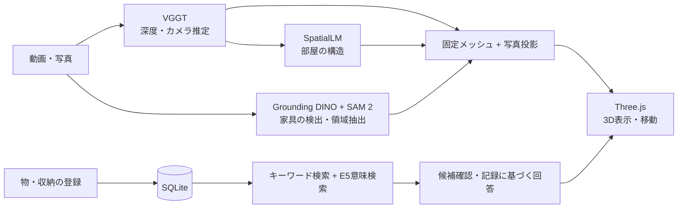

<p align="center"></p>

# スパメモ — 空間を、まるごと記憶する。

**部屋を撮影し、3D空間と物の置き場所を記録して、「充電ケーブルどこ？」と探せるWebアプリ。**

筑波AIハッカソン2026秋・チームBで制作したプロトタイプを基に、萱内一真（[@kayauch](https://github.com/kayauch)）の担当・設計判断・改善の過程を紹介するポートフォリオです。チーム開発とAI支援を含みます。

[発表スライドを見る](https://docs.google.com/presentation/d/1yar8lVbJm3M89MrMCMFFWcrM5ZT_PA8cS6BB84T22tQ/edit) · [本人の担当とAIの活用](docs/contributions.md) · [技術構成](docs/architecture.md) · [起動・検証方法](docs/setup.md)

## 何を解決するか

物の名前だけでなく、「どの部屋の、どの収納の、どの段にあるか」まで残したい。スパメモは、部屋の見た目と収納・物の記録を結びつけ、置き場所を思い出すための空間メモリを目指しています。

## 主な機能

| 流れ | できること |
| --- | --- |
| 撮る・つくる | 動画から部屋の形状と家具を推定し、固定メッシュに写真を貼る |
| 見る・歩く | ブラウザで3D表示し、俯瞰と移動を切り替える |
| 記録する | 収納に物・写真・名前・段や左右の位置を登録する |
| 探す | キーワードと意味の近さを使って検索し、保存した置き場所を文章で示す |
| 直す | 追加撮影による写真の補修、認識した物の名前変更・非表示、収納の強調表示 |

検索候補が弱い、または複数候補が拮抗する場合は、場所を断定せず候補確認につなげます。回答は保存済みの記録を基にしており、現在の実物の位置を追跡する機能ではありません。

## 技術の組み合わせ



Python / FastAPIをバックエンドに、JavaScript / Three.jsを表示に使用しています。形状推定・家具認識・検索のモデルを役割ごとに組み合わせています。モデルと外部ライブラリの出典は[第三者技術の一覧](THIRD_PARTY.md)にまとめています。

## 私が担当したこと

- 課題設定と体験設計：「部屋を生成する」から「記録した物を探す」までの流れを具体化。
- 技術の検討：先行研究・論文を調べる方針を提案し、点群、Gaussian Splatting、固定メッシュなどの役割を比較。
- 改善方針の提案：カメラの位置合わせと固定メッシュへの写真投影、足りない面への追加撮影などを検討。
- 実機検証：自分で部屋を撮影し、壁と家具の混同、テクスチャの欠け、上下方向、収納の厚みなどの問題を発見。
- UIと優先順位の判断：撮影・修正・収納登録・検索を実際に操作し、改善点を指示して結果を確認。

AIには調査整理、実装、修正案、テスト、資料作成を支援させました。課題の発見、採用する方針の判断、実空間での検証は人が担っています。[共同制作の帰属と詳しい分担](docs/contributions.md)

## 手元で試す

実際の室内写真や学習済みモデルは、このリポジトリには含めていません。まずは**合成データのデモ**で、画面・物の記録・キーワード検索を確認できます。Python 3.11を想定しています。

```powershell
# Windows PowerShell / リポジトリのルートで実行
py -3.11 -m venv .venv
.\.venv\Scripts\python.exe -m pip install --upgrade pip
.\.venv\Scripts\python.exe -m pip install torch torchvision --index-url https://download.pytorch.org/whl/cpu
.\.venv\Scripts\python.exe -m pip install -r requirements.txt
.\.venv\Scripts\python.exe -m pip install -e .
$env:SEMANTIC_SEARCH_ENABLED = '0'
$env:RECONSTRUCTION_DEVICE = 'cpu'
.\.venv\Scripts\python.exe scripts/seed_local_demo.py
.\.venv\Scripts\python.exe -m uvicorn spatial_memory.api:app --host 127.0.0.1 --port 8001
```

[ローカルの合成デモを開く](http://127.0.0.1:8001/?scene=00000000-0000-4000-8000-000000000001)。部屋を開いて「充電ケーブルどこ？」などを検索できます。

このデモは合成点群・仮画像・サンプルの物を使用し、実写からの3D生成品質を示すものではありません。意味検索のモデル取得、本物の動画からの生成、検証した範囲は[起動手順](docs/setup.md)を参照してください。

## 現時点の制約

- 撮影時のブレ、反射、遮蔽、特徴の少ない壁は、位置合わせや写真の貼り付けに影響します。
- 壁や収納の寸法・境界は推定です。測量用途の精度は保証していません。
- 写真のない面を周囲の色や模様で補う処理には、実際には撮影していない見た目が含まれます。
- 小物の登録には人の入力・確認を含みます。すべての物を自動的に認識・記憶できる段階ではありません。
- 実写のフル生成にはGPU、モデル、SpatialLM用の別環境などが必要です。すべての環境での一括セットアップは未整備です。

## コードの見どころ

| 関心 | 主なコード |
| --- | --- |
| API・データ構造 | [api.py](src/spatial_memory/api.py)、[models.py](src/spatial_memory/models.py)、[storage.py](src/spatial_memory/storage.py) |
| 撮影から生成まで | [capture_jobs.py](src/spatial_memory/capture_jobs.py)、[room_jobs.py](src/spatial_memory/room_jobs.py) |
| 写真と3Dの対応 | [photo_alignment.py](src/spatial_memory/photo_alignment.py)、[wall_evidence.py](src/spatial_memory/wall_evidence.py)、[solid_room.py](src/spatial_memory/solid_room.py) |
| 検索と曖昧さの扱い | [service.py](src/spatial_memory/service.py)、[semantic.py](src/spatial_memory/semantic.py)、[search_answer.py](src/spatial_memory/search_answer.py) |
| 3D表示・追加撮影 | [solid-room.js](web/solid-room.js)、[repair-capture-plan.mjs](web/repair-capture-plan.mjs) |
| 回帰テスト | [tests/](tests/) |

## 共同制作・公開範囲

共同制作メンバー：萱内一真、游方興。元の共同開発リポジトリは[TsukubaDevGuild/hackathon-2026-autumn-team-b](https://github.com/TsukubaDevGuild/hackathon-2026-autumn-team-b)です（アクセス制限あり）。UI由来の説明は[web/yuu-ui/README.md](web/yuu-ui/README.md)にも保持しています。

この公開版は2026年9月28日時点の手元の実装から、ソース・テスト・汎用スクリプトを整理したスナップショットです。実部屋の写真・動画・音声、DB、モデル重み、個人環境の設定、元のGit履歴は含みません。全コードを一人で書いたことを意味するものではありません。

第三者コードの権利表示は保持しています。利用モデル・ライブラリにはそれぞれの利用条件が適用されます。プロジェクト全体への新たなOSSライセンスは設定していません。
