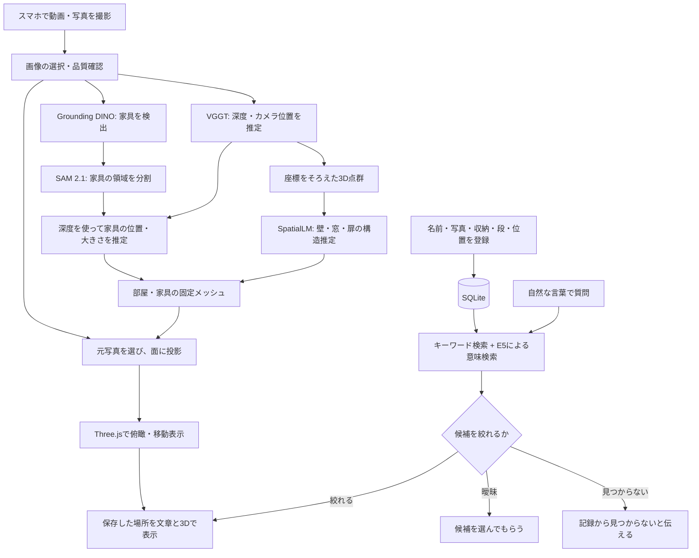

# スパメモの技術構成

スパメモは、撮影した部屋を3Dで記録し、保存した物の名前から「どの収納にあるか」を探すアプリです。**部屋の形を作る処理**と、**物の記録を検索する処理**を分け、3D画面で結びつけています。

この資料は公開コードの主要な経路を説明します。モデルの精度をアプリの実測値として扱わず、実装済みの機能と、推定・補完・実験用の機能を区別します。

## 全体の流れ

部屋の写真だけから、収納内の小物がすべて自動で登録される仕組みではありません。小物の名前・写真・収納場所を人が登録し、必要に応じて確認・修正します。

## 技術ごとの役割

| 技術 | このアプリで担当すること | 主な実装 |
|---|---|---|
| ブラウザのカメラAPI・JavaScript | 動画・追加写真の撮影、横向き案内、撮影対象の切り替え | `web/capture-recorder.mjs`、`web/live-room-camera.mjs` |
| VGGT-1B | 選択した画像から深度・カメラ情報を求め、点群を作る基礎情報を得る | `src/spatial_recon/adapters/vggt.py` |
| SpatialLM 1.1 | 点群から壁・窓・扉などの配置を推定する | `scripts/prepare_spatiallm.py`、`scripts/run_spatiallm.py` |
| Grounding DINO Tiny + SAM 2.1 | 写真内の家具を検出し、その画像領域を切り分ける | `scripts/infer_image_furniture.py` |
| OpenCV・Open3D・Trimeshなど | 画像、点群、座標、メッシュを処理する | `src/spatial_memory/`、`scripts/build_solid_room.py` |
| Three.js | 部屋の描画、俯瞰・移動、収納や検索対象の強調表示 | `web/solid-room.js`、`web/storage-highlight.mjs` |
| FastAPI | ブラウザの要求を受け、撮影・生成・記録・検索へつなぐ | `src/spatial_memory/api.py`、`capture_api.py` |
| SQLite | 部屋・物・親収納との関係・座標などを保存する | `src/spatial_memory/storage.py`、`models.py` |
| multilingual-e5-small | 質問と登録文の意味の近さを計算する | `src/spatial_memory/semantic.py` |

各モデル・ライブラリの公式資料は [THIRD_PARTY.md](../THIRD_PARTY.md) にまとめています。

## 1. 写真から部屋を作る

動画の全フレームを無条件に推論へ渡すのではなく、候補を抽出し、品質や処理量を考慮して画像を選びます。追加写真も入力候補になります。

VGGTが画像の奥行きと撮影カメラを推定します。深度を共通の座標へ戻すことで色付きの点群を作り、点群の密度・外れ値・向きを整理してSpatialLMへ渡します。SpatialLMの結果を使って床・壁・天井などの骨格を組み立てます。

最終的な家具の配置には別の経路を使います。Grounding DINOで家具の枠を検出し、SAM 2.1で領域を切り分け、その領域の深度を3Dへ戻します。複数画像の観測をまとめて、家具の位置と簡易的な形状を推定します。

この分離は、平面状の棚や箱を壁と混同したり、家具の写真を壁に貼ってしまったりする問題に対応するための設計です。家具の裏側や棚の内部まで正確に復元できるという意味ではありません。

関連コード: [`capture_jobs.py`](../src/spatial_memory/capture_jobs.py)、[`room_jobs.py`](../src/spatial_memory/room_jobs.py)、[`image_furniture.py`](../src/spatial_memory/image_furniture.py)

## 2. 固定した形に写真を貼る

通常の部屋表示では、床・壁・天井・家具を固定メッシュとして作り、その面に元写真を投影します。奥行きの整合性、遮蔽、撮影の向きなどを確認して使用する画像を選びます。形を固定するため視点の移動だけでは形状自体は変わりませんが、カメラ位置や形の推定が誤っていれば写真はずれます。

位置合わせを補正する経路や、面ごとに写真の採用領域を扱う処理もあります。写真がない壁・天井を周辺の模様で補う場合は、観測された領域と補完した領域を区別して情報を残します。

**入力された写真の枚数、推論に使用した枚数、最終テクスチャに採用した枚数は別です。** 模様の補完も、見えていなかった現実を復元した証拠にはなりません。

関連コード: [`build_solid_room.py`](../scripts/build_solid_room.py)、[`photo_alignment.py`](../src/spatial_memory/photo_alignment.py)、[`regional_textures.py`](../src/spatial_memory/regional_textures.py)、[`material_completion.py`](../src/spatial_memory/material_completion.py)

## 3. 不足箇所を追加撮影する

部屋の修正では、面や家具に対応した撮影候補を並べ、カメラを表示したまま順に撮影できるようにしています。横向きを案内し、撮影後は次の対象へ進みます。新しい写真を使って部屋の別の版を作ります。

撮影候補は推定情報から作る案内であり、「撮影したら必ず穴が埋まる」という保証ではありません。視点の重なり、ブレ、照明、遮蔽、カメラの推定誤差によって採用状況が変わります。

関連コード: [`repair-capture-plan.mjs`](../web/repair-capture-plan.mjs)、[`live-room-camera.mjs`](../web/live-room-camera.mjs)、[`capture_target.py`](../src/spatial_memory/capture_target.py)

## 4. 登録した物を、名前と意味で検索する

物の名前・別名・説明・写真・親収納・段・左右・3D座標などを記録します。検索は、表記の一致を評価するキーワード検索と、E5のテキスト埋め込みによる意味検索を組み合わせます。画像そのものの類似検索ではありません。

結果は `matched`（絞り込めた）、`ambiguous`（曖昧）、`not_found`（見つからない）に分かれます。意味の近さが低い候補は除外し、上位が僅差なら自動で一つに決めず、ユーザーに確認します。スコアや閾値は正答確率ではなく、誤回答を完全に防ぐ保証でもありません。

現在の場所の回答は、保存された収納関係から定型文で作ります。たとえば「ケーブルは収納の中・上から1段目にあると記録されています」のように、**記録を根拠に答えます**。物を実際に動かした場合は記録の更新が必要です。

関連コード: [`search.py`](../src/spatial_memory/search.py)、[`semantic.py`](../src/spatial_memory/semantic.py)、[`service.py`](../src/spatial_memory/service.py)、[`search_answer.py`](../src/spatial_memory/search_answer.py)

## 実行構成と、研究用コードの位置づけ

ブラウザは画面表示・撮影・操作を担当し、FastAPIのサーバーが記録・検索と生成処理をまとめます。生成ジョブは状態をファイルに保存し、画面から進捗を再確認できます。完全なGPU推論には、モデル重み・外部モデル実装・対応する実行環境の準備が必要です。現行のSpatialLM起動スクリプトはWindowsからWSLへ処理を渡す構成です。

本リポジトリには、Depth Anything 3、VGGT-OMEGA、COLMAP、2D/3D Gaussian Splatting、音声認識、LLM接続などの比較・研究用コードも含まれます。これらがすべて通常の部屋生成や場所の回答に使われるわけではありません。主要な部屋表示は固定メッシュで、現在の場所の回答は上記の記録ベースの定型文です。

## 現在の限界

- 白い壁、反射、ブレ、遮蔽、撮影の重なり不足などで形や写真の位置が崩れることがあります。
- 実寸や上下方向には推定・仮定が含まれます。測量用の精度を保証しません。
- 小物の全自動登録、隠れた棚内部の復元、物の移動の自動追跡は完成していません。
- 家具の浮き・重なりのチェックは候補を示すもので、人の確認を補助します。
- 復元精度、検索正答率、探し物にかかる時間の短縮は、複数の部屋・利用者で継続評価する対象です。

この公開版には、実際に撮影した部屋の動画・写真・DB・推論結果と、モデル重みを同梱していません。
